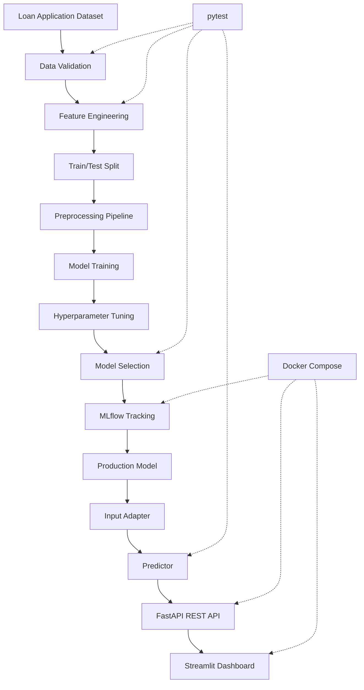

# 🏦 Production-Grade Loan Risk Prediction System

### An end-to-end Machine Learning & MLOps project for predicting loan repayment risk

\<p align="center">
&#x20; \
&#x20; \
&#x20; \
&#x20; \
&#x20; \
&#x20; \
\</p>

\<p align="center">
&#x20; \<b>From raw loan application data to a deployable machine learning prediction system.\</b>
\</p>

---

## 📌 Project Overview

This project implements an end-to-end **Loan Risk Prediction System** using Machine Learning and MLOps practices.

The objective is to build a system that analyzes loan application information and predicts the risk associated with a loan applicant.

Rather than stopping at model training, this project focuses on the complete machine learning lifecycle:

- Data validation and preprocessing
- Feature engineering
- Model development and selection
- Experiment tracking with MLflow
- Production model management
- Prediction through a REST API
- Interactive dashboard
- Containerization using Docker
- Automated testing and future CI/CD integration

The central idea is to transform a machine learning model into a usable, maintainable software system.

## 🏗️ System Architecture



## ⚙️ Technology Stack

| Category            | Technologies                              |
| ------------------- | ----------------------------------------- |
| Programming         | Python                                    |
| Data Processing     | Pandas, NumPy                             |
| Machine Learning    | Scikit-learn                              |
| Models              | Logistic Regression, Random Forest        |
| Experiment Tracking | MLflow                                    |
| Model Serialization | Joblib                                    |
| API Development     | FastAPI                                   |
| API Validation      | Pydantic                                  |
| Dashboard           | Streamlit                                 |
| Containerization    | Docker, Docker Compose                    |
| Testing             | pytest                                    |
| Version Control     | Git, GitHub                               |
| CI/CD               | GitHub Actions (planned / to be verified) |

## 📊 Dataset

The project uses a loan application dataset based on the Home Credit Default Risk dataset.

The main training dataset contains:

| Attribute         |    Value |
| ----------------- | -------: |
| Training records  |  307,511 |
| Original features |      122 |
| Target column     | `TARGET` |
| Duplicate records |        0 |

The target variable represents the loan repayment outcome.

The dataset contains numerical and categorical variables, along with missing values that require preprocessing.

**Note:** The original dataset is not included in this repository unless explicitly added. Follow the dataset's original access and licensing requirements.

## 🧠 Machine Learning Pipeline

### 1. Data Validation

The input dataset is checked for structural and quality issues before model development.

Validation includes:

- Dataset structure
- Target column availability
- Data types
- Missing values
- Duplicate records

### 2. Feature Engineering

Additional features are generated to improve the information available to the machine learning models.

The latest known model input representation contains approximately **133 features**, excluding the target variable.

### 3. Preprocessing

Numerical and categorical features are processed using a Scikit-learn preprocessing pipeline.

The fitted preprocessing component is saved as:

```text
preprocessor.joblib
```

### 4. Model Training

The project includes model development using:

- Logistic Regression
- Random Forest

The architecture uses a model factory to separate model creation from the rest of the training pipeline.

### 5. Model Selection

A dedicated model selection component compares candidate models according to the project's evaluation criteria.

The selected model can then be used for production inference.

### 6. Production Inference

The production model is stored as a serialized artifact:

```text
production_model.joblib
```

An `InputAdapter` aligns incoming prediction data with the feature structure expected by the production model.

A separate `Predictor` component handles inference.

This separation helps avoid duplicating model-loading and prediction logic across the API and dashboard.

## 📈 MLflow Experiment Tracking

MLflow is integrated into the project to support experiment tracking and model lifecycle management.

It provides a place to track model development and inspect experiment results.

The Docker configuration uses the following addresses:

| Environment            | MLflow address          |
| ---------------------- | ----------------------- |
| Inside Docker network  | `http://mlflow:5000`    |
| Host machine / browser | `http://localhost:5001` |

The internal Docker address is intentionally different from the host address.

## 🚀 Application Components

### FastAPI REST API

FastAPI provides an interface through which external applications can request predictions from the trained model.

The API is designed to connect incoming data with the InputAdapter and Predictor components.

Once running, the default FastAPI documentation is generally available at:

```text
http://localhost:8000/docs
```

### Streamlit Dashboard

The Streamlit dashboard provides a user-facing interface for interacting with the prediction system.

It is accessible at:

```text
http://localhost:8501
```

### Docker Compose

Docker Compose manages the application's services.

The current setup includes:

| Service         | Purpose             |
| --------------- | ------------------- |
| `loan-risk-api` | Model inference API |
| `dashboard`     | User interface      |
| `mlflow`        | Experiment tracking |

## 🐳 Running the Project

### Prerequisites

Install the following:

- Python 3.11+
- Git
- Docker Desktop
- Docker Compose

### 1. Clone the repository

```bash
git clone https://github.com/YOUR_GITHUB_USERNAME/loan-risk-prediction.git

cd loan-risk-prediction
```

Replace the repository URL with your actual GitHub repository URL.

### 2. Create a virtual environment

```bash
python3 -m venv .venv
```

Activate it on macOS/Linux:

```bash
source .venv/bin/activate
```

### 3. Install dependencies

If the repository contains a `requirements.txt`:

```bash
pip install -r requirements.txt
```

### 4. Configure environment variables

Create a `.env` file if required by the project.

Example:

```env
MLFLOW_TRACKING_URI=http://localhost:5001
```

The API container should continue to use the Docker-internal address:

```env
MLFLOW_TRACKING_URI=http://mlflow:5000
```

Do not commit secrets or private API credentials.

### 5. Start the Docker services

From the directory containing the Docker Compose configuration:

```bash
docker compose up --build
```

### 6. Access the applications

| Component            | URL                                                      |
| -------------------- | -------------------------------------------------------- |
| FastAPI              | [http://localhost:8000](http://localhost:8000)           |
| FastAPI Swagger Docs | [http://localhost:8000/docs](http://localhost:8000/docs) |
| Streamlit Dashboard  | [http://localhost:8501](http://localhost:8501)           |
| MLflow UI            | [http://localhost:5001](http://localhost:5001)           |

### 7. Stop the services

```bash
docker compose down
```

To remove containers and associated Compose-managed volumes:

```bash
docker compose down -v
```

**Warning:** The `-v` option can remove persisted data stored in Compose-managed volumes. Use it only when that is intended.

## 🧪 Testing

The project uses `pytest` to test individual components and their behavior.

Run the test suite:

```bash
pytest -q
```

Run tests with detailed output:

```bash
pytest -v
```

The ModelSelector tests have been fixed and confirmed passing during development. The full test suite should be rerun before publishing a final test count.

## 📁 Project Structure

The exact repository structure may evolve as development continues. The following is a conceptual view of the major components:

```text
loan-risk-prediction/
│
├── src/
│   ├── data/
│   ├── validation/
│   ├── features/
│   ├── preprocessing/
│   ├── models/
│   ├── prediction/
│   └── api/
│
├── tests/
│
├── artifacts/
│
├── dashboard/
│
├── docs/
│
├── Dockerfile
├── docker-compose.yml
├── requirements.txt
├── .gitignore
└── README.md
```

The actual directory names should be updated to match the implemented repository.

## 🔍 Key Engineering Concepts Demonstrated

| Concept                | Purpose                                      |
| ---------------------- | -------------------------------------------- |
| Feature Engineering    | Creates useful model inputs                  |
| Preprocessing Pipeline | Makes raw data model-ready                   |
| ModelFactory           | Separates model creation from training logic |
| ModelSelector          | Compares candidate models                    |
| MLflow                 | Tracks experiments and model lifecycle       |
| InputAdapter           | Aligns incoming data with model features     |
| Predictor              | Encapsulates production inference            |
| FastAPI                | Exposes predictions through HTTP             |
| Streamlit              | Provides an interactive interface            |
| Docker                 | Packages application services                |
| pytest                 | Tests application behavior                   |

## 🛣️ Development Roadmap

- [x] Dataset loading and inspection
- [x] Data validation
- [x] Feature engineering
- [x] Train/test split
- [x] Preprocessing pipeline
- [x] ModelFactory
- [x] Logistic Regression
- [x] Random Forest
- [x] ModelSelector
- [x] Production model artifact
- [x] InputAdapter
- [x] Predictor
- [x] MLflow integration
- [x] Docker Compose services
- [x] FastAPI service running
- [x] Streamlit dashboard running
- [x] ModelSelector tests fixed
- [x] GitHub repository uploaded
- [x] Verify full test suite
- [x] Verify API request/response schemas
- [x] Complete API documentation
- [x] Finalize architecture documentation
- [x] Add screenshots and usage examples
- [ ] GitHub Actions CI workflow
- [ ] Model monitoring and drift detection

*The checklist reflects the latest known development status and should be updated after verification.*

## 🔮 Future Improvements

Potential extensions include:

- Automated model retraining
- Data drift detection
- Prediction monitoring
- Model performance monitoring
- Improved explainability using SHAP
- API authentication and rate limiting
- Automated Docker image builds
- CI/CD pipeline using GitHub Actions
- Cloud deployment

These are planned extensions, not claims about currently implemented functionality.

## 💡 Why This Project?

A machine learning model is only one part of a real-world ML system.

This project explores how to move beyond model training and build an application that can:

1. Accept input data.
2. Validate and transform it.
3. Generate predictions.
4. Expose predictions through an API.
5. Provide an interactive dashboard.
6. Track experiments and manage model artifacts.
7. Run consistently using containers.
8. Be tested and maintained like a software application.

The focus is on understanding the complete journey from **data to production inference**.

## 👨‍💻 Author

**[Your Name]**

M.Sc. (Tech) Engineering Physics
Electronics Specialization
National Institute of Technology Warangal

Interested in:

- Machine Learning Engineering
- Artificial Intelligence
- MLOps
- Production ML Systems
- Software and Hardware Integration

[GitHub](https://github.com/YOUR_GITHUB_USERNAME) · [LinkedIn](YOUR_LINKEDIN_URL)

---

\<p align="center">
&#x20; \<b>Built to explore the engineering behind production machine learning systems.\</b>
\</p>
